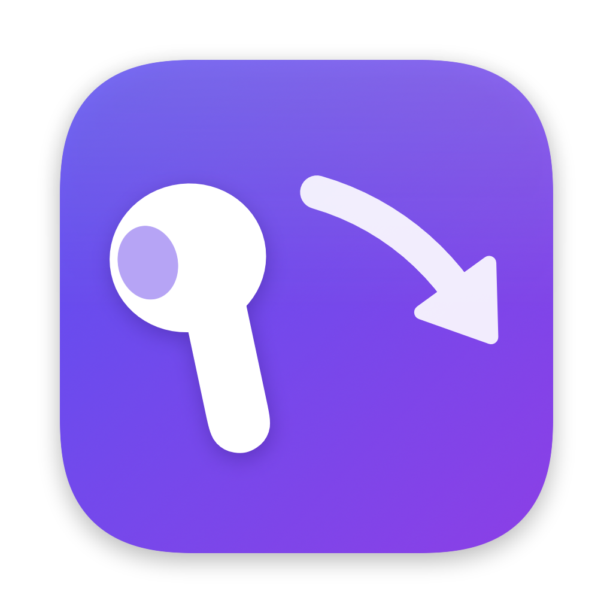

<p align="center"></p>

<h1 align="center">AirAnki</h1>

<p align="center"><b>Review Anki with a flick of your AirPod.</b><br>
A free Mac app that turns one AirPod into a wireless Anki clicker — no extra gadget needed.</p>

---

Anki remotes are great for long review sessions: lean back, hold something in your hand, click through cards. AirAnki gives you the same thing with the AirPods you already own. Take one out, hold it like a clicker, and flick your wrist.

| Do this | On the question | On the answer |
| --- | --- | --- |
| **Flick right** | Show answer | ✅ **Easy** (or Good — your choice) |
| **Flick left** | Show answer | ❌ **Again** |
| **Twist** | Undo | ↩️ **Undo** |

Every action pops a small coloured confirmation over the card in Anki — green for Easy, red for Again, grey for Undo — so you always know what registered without looking away.

## What you need

- A Mac running **macOS 14 Sonoma** or later (Apple silicon or Intel)
- **AirPods** with motion sensors: AirPods Pro (any generation), AirPods 3rd/4th generation or AirPods Max
- **[Anki](https://apps.ankiweb.net)** desktop (version 23.10 or later)

## Install

1. Download `AirAnki-1.0.0.dmg` from the Releases page, open it and drag **AirAnki** to **Applications**.
2. Open AirAnki. It's signed and notarized by Apple, so it opens like any other app.
3. Follow the setup guide. It takes about two minutes:
   - **Get your AirPod ready.** Connect your AirPods to your Mac and turn off **Automatic Ear Detection** (System Settings → your AirPods). Take one AirPod out and hold it.
   - **Connect to Anki.** Click **Install** to add the small AirAnki add-on to Anki, then restart Anki.
   - **Teach AirAnki your flicks.** Flick right 6 times, left 6 times and twist 6 times — the way you naturally would.
   - **Give it a go.** Practise each gesture; nothing reaches Anki until you finish the guide.

AirAnki then lives in your menu bar. Open a deck in Anki and start flicking.

## Tips

- **Hold it loosely**, stem pointing down, between thumb and finger. Small, quick wrist flicks work best — you don't need to flick hard.
- **Keep the other AirPod in its case.** macOS reads motion from one AirPod at a time.
- **If flicks are missed or confused**, recalibrate from the AirAnki window or the menu bar. Your grip matters more than strength, so calibrate holding it the way you'll study.
- **Sensitivity** and **flick right = Easy or Good** are in Settings. You can also swap left and right.
- **Pause** from the menu bar when you put the AirPod back in your ear for music.

## Troubleshooting

**"Can't hear your AirPod"** — Make sure your AirPods are connected to this Mac (not your phone), Automatic Ear Detection is off, and the AirPod has some charge. Keep **Keep AirPods awake** on in Settings: it plays inaudible silence so the AirPods don't disconnect while out of your ear.

**"Open Anki" / not connecting** — Anki must be running. If you've just installed the add-on, restart Anki once. The add-on appears in Anki as **AirAnki Bridge** under Tools → Add-ons.

**Motion permission** — If you clicked "Don't Allow", turn AirAnki on in **System Settings → Privacy & Security → Motion & Fitness**.

**I don't want the coloured pop in Anki** — Anki → Tools → Add-ons → AirAnki Bridge → Config, set `"feedback_flash": false`.

**Already use AnkiConnect?** AirAnki works with it too, but the AirAnki add-on is noticeably faster.

## Privacy

AirAnki works entirely on your Mac. It reads your AirPod's motion only to recognise gestures, talks to Anki through a private local connection, and sends nothing over the internet. There are no accounts, analytics or ads.

## Why only one AirPod?

macOS streams motion from one AirPod at a time, so AirAnki is designed around a single AirPod in your hand. Gestures that need both AirPods at once aren't possible.

## Build from source

You only need Apple's Command Line Tools (`xcode-select --install`); Xcode is optional.

```sh
./scripts/test.sh            # Swift + add-on tests
./scripts/build_app.sh       # build/AirAnki.app
./scripts/build_release.sh   # dist/ DMG, .ankiaddon and checksums
```

See [docs/DEVELOPMENT.md](docs/DEVELOPMENT.md) for how gesture recognition works and [docs/RELEASING.md](docs/RELEASING.md) for cutting a release.

## License

MIT — see [LICENSE](LICENSE). Third-party credits are in [THIRD_PARTY_NOTICES.md](THIRD_PARTY_NOTICES.md).

AirAnki is an independent project, not affiliated with or endorsed by Apple or Anki. AirPods is a trademark of Apple Inc.
